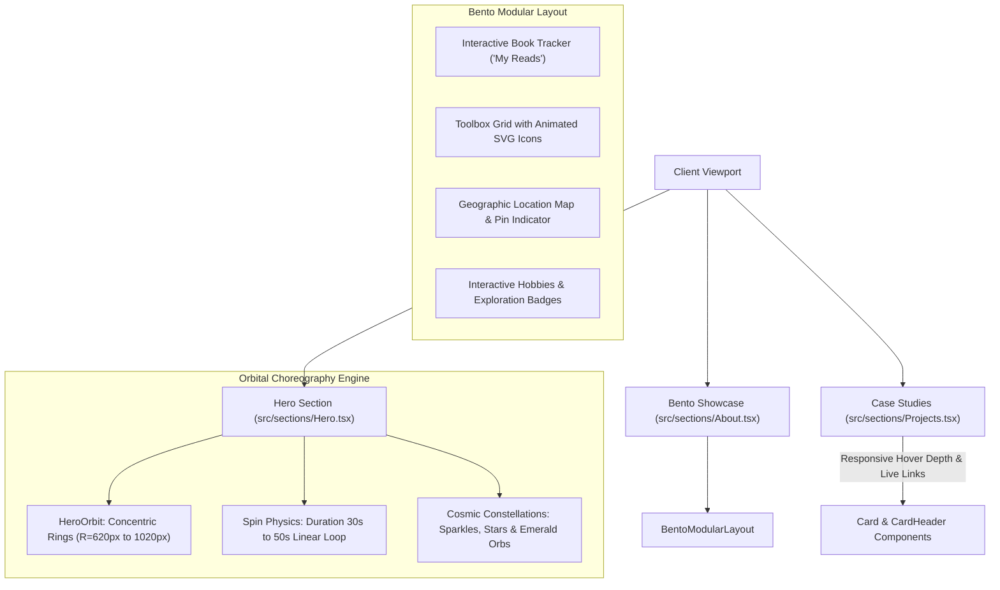

# 🌌 Cosmic Developer Portfolio — Next.js 14, Framer Motion & Orbital Choreography

<div align="center">


**A high-craft, cinematic personal portfolio website engineered with Next.js 14 App Router, TypeScript, Framer Motion orbital physics, Tailwind CSS, and bespoke Bento grid layouts.**

[](https://nextjs.org/)
[](https://www.typescriptlang.org/)
[](https://www.framer.com/motion/)
[](https://tailwindcss.com/)
[](https://pagespeed.web.dev/)

</div>

---

## 📖 Overview

**Cosmic Portfolio** is a production-grade personal portfolio engineered to showcase technical depth, aesthetic precision, and interactive motion design. Defying standard cookie-cutter developer profiles, it draws inspiration from cosmic mechanics, deep dark-mode palettes, and modern Scandinavian minimalism.

Built with **Next.js 14 React Server Components** and **Framer Motion**, the experience blends high-density technical storytelling with playful physics: mathematical orbital rings rotating around an interactive 3D avatar, an infinite scrolling kinetic tape, and an information-dense Bento Grid presenting real-world engineering projects.

---

## 🏗️ Architectural & Motion Highlights



### 1. Solar Orbital Mathematics (`HeroOrbit.tsx`)
Concentric orbital rings rotate at varying radial distances (620px, 710px, 800px, 980px, 1020px). Each orbit encapsulates child sparkle icons, animated emerald pulses, and distant star vectors using CSS transforms and Framer Motion keyframe loops. The inner contents counter-rotate against the parent vector to maintain vertical readability while spinning.

### 2. Infinite Kinetic Marquee (`Tape.tsx`)
A high-velocity infinite marquee ticker built with pure CSS transforms and linear animation keyframes, ensuring zero layout shifts (CLS) and seamless looping across all viewport widths.

### 3. Bento Grid Design System (`About.tsx`)
A modern multi-column card layout combining:
- **Interactive Toolbox Icons**: Reusable vector icons (`ToolboxIcon.tsx`) rendered with SVGR and Tailwind hover transforms.
- **Geographic Radar**: Interactive localized map view (`map.png`) indicating developer location and availability status.
- **Hobby Chip Cloud**: Kinetic pill badges displaying developer interests with subtle spring physics.

---

## ✨ Core Sections & Features

- 🪐 **Interactive Cosmic Hero**: Dynamic avatar, rotating solar orbit rings, and status badge indicating *"Available for high-impact roles"*.
- 💼 **Deep-Dive Engineering Projects**: Featured project showcases (`LunarLane`, `EcommerceBunny`, `ToDoApp`, `Web3Campaign`) complete with year, client impact, live demo links, and high-fidelity mockups.
- ⚡ **Infinite Word Tape**: High-contrast scrolling ticker highlighting engineering principles: *Scalable, Secure, Responsive, Dynamic, High-Performance, Accessible*.
- 🛠️ **Tech Toolbox**: Interactive icon ecosystem covering Next.js, React, TypeScript, Tailwind, Chrome DevTools, and modern web APIs.
- 📬 **Frictionless Contact Section**: Interactive card layout with direct email mailto triggers, LinkedIn, and GitHub links.

---

## 📂 Project Structure

```text
├── src/
│   ├── app/
│   │   ├── layout.tsx             # Root layout, Inter & Calistoga typography
│   │   ├── page.tsx               # Primary single-page portfolio assembly
│   │   └── globals.css            # Dark mode tokens, grain overlay & animations
│   ├── assets/
│   │   ├── icons/                 # SVGR vector icons (nextjs, react, tailwind, etc.)
│   │   └── images/                # Project mockups, book cover, grain & memoji
│   ├── components/
│   │   ├── Card.tsx               # Glassmorphic card container with gradient borders
│   │   ├── CardHeader.tsx         # Standardized section card header with badges
│   │   ├── HeroOrbit.tsx          # Orbital rotation component with radius props
│   │   ├── SectionHeader.tsx      # Editorial eyebrow, title & description
│   │   ├── ToolboxIcon.tsx        # SVG icon wrapper with gradient fills
│   │   └── ToolboxItems.tsx       # Infinite marquee skills row
│   └── sections/
│       ├── Header.tsx             # Floating pill navigation bar with active state
│       ├── Hero.tsx               # Cosmic orbital avatar presentation
│       ├── Projects.tsx           # Featured project showcase & case studies
│       ├── Tape.tsx               # Infinite kinetic marquee ticker
│       ├── About.tsx              # High-density Bento Grid
│       ├── Contact.tsx            # Call-to-action banner
│       └── Footer.tsx             # Social links & copyright
├── tailwind.config.ts             # Custom keyframes, animations & color tokens
└── package.json
```

---

## 🚦 Getting Started

### Prerequisites
- Node.js 18+

### Setup Instructions

1. **Clone the repository:**
   ```bash
   git clone https://github.com/Khanhbroo/nextjs-portfolio.git
   cd nextjs-portfolio
   ```

2. **Install dependencies:**
   ```bash
   npm install
   ```

3. **Start local development server:**
   ```bash
   npm run dev
   ```
   Open [http://localhost:3000](http://localhost:3000) to inspect the portfolio.

4. **Build production bundle:**
   ```bash
   npm run build
   ```

---

## 👨‍💻 Author

**Nguyen Quoc Khanh (KhanhBro)**  
- GitHub: [@Khanhbroo](https://github.com/Khanhbroo)  
- Email: [khanhmathias532211@gmail.com](mailto:khanhmathias532211@gmail.com)
